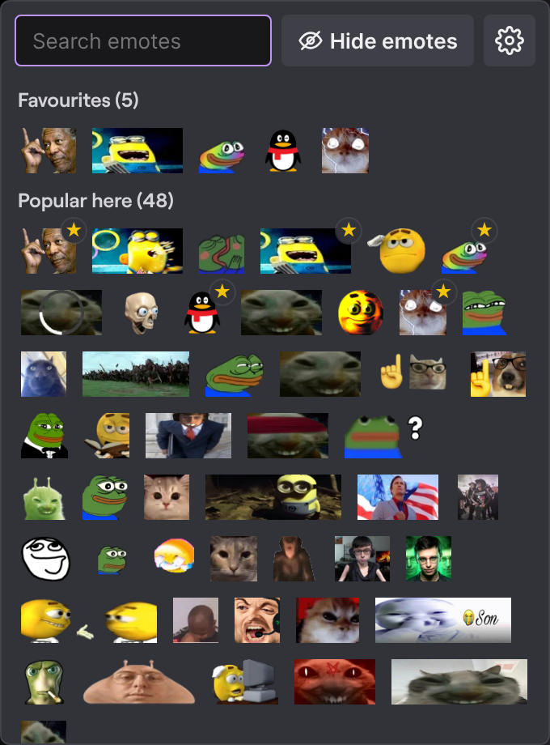
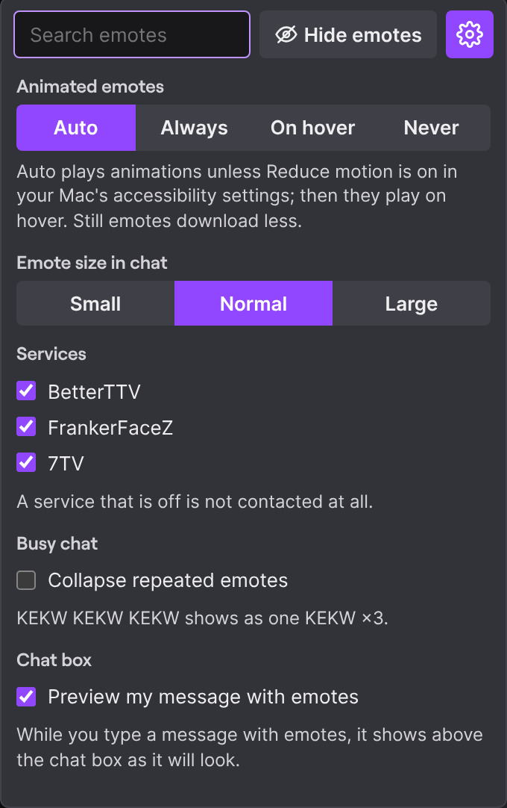
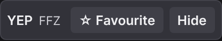
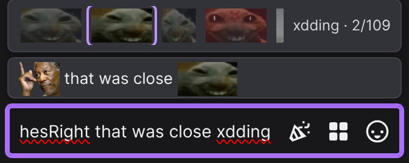

# EmoteKit for Twitch

A userscript that adds BetterTTV, FrankerFaceZ and 7TV emotes to Twitch chat and shows at a glance which emotes each channel uses most, with tools to find, send, favourite and hide emotes, and settings for how chat looks.

<p>
  
  
</p>

- **No account, no tracking.** Nothing about what you watch or type leaves your browser. Favourites, hidden emotes, settings and usage counts are stored locally.
- **No dependencies.** One file. It contacts only Twitch and the three emote services.
- **Low data and CPU use.** About 0.2 ms of CPU per chat message. With animations off, emote images on a busy channel take about 0.5 MB in the first minute instead of 9.5 MB.

What it does:

- **Emotes in chat** from all three services, in live and popout chat, with zero-width emotes stacked and a preview on hover.
- **Emote picker:** your favourites, the emotes this channel's chat uses most, emotes the channel added recently, then every emote, with search.
- **Favourites and hiding:** click an emote in chat or in the picker to favourite or hide it. A hidden emote shows as its name; click the name to show it again.
- **Typing:** Tab completion ranked by your favourites and the channel's usage, with a strip of the matches, and a preview of your message with emotes.
- **Display settings:** animated emotes always, on hover or never; three emote sizes; each service on or off; repeated emotes collapsed into one with a count.

## Install

### Safari on Mac

1. Install [Userscripts](https://github.com/quoid/userscripts) from the Mac App Store. It's free.
2. In Safari, open **Settings → Extensions**, turn on **Userscripts**, and allow it on `twitch.tv`.
3. Open **[Install EmoteKit](https://raw.githubusercontent.com/zyknows/emotekit/main/emotekit.user.js)** in Safari. You'll see the script's code. Click the Userscripts icon in the toolbar and choose **Install**.
4. Open any Twitch channel. The grid button next to the chat box opens the emote picker.

### Chrome or Firefox

1. Install the Tampermonkey or Violentmonkey extension.
2. Open **[Install EmoteKit](https://raw.githubusercontent.com/zyknows/emotekit/main/emotekit.user.js)** and confirm.

### Updating

Tampermonkey and Violentmonkey update EmoteKit on their own. In Userscripts, open the install link again and choose **Install**. Your favourites, hidden emotes and settings are kept.

## How to use

### Emote picker

Click the grid button next to the chat box. The picker lists:

1. **Favourites**, in the order you added them.
2. **Popular here:** the emotes this channel's chat uses most. EmoteKit counts them as chat comes in (once per message), and older counts fade over a few weeks.
3. **New in this channel:** 7TV emotes the channel added in the last 14 days.
4. Every channel and global emote, by service.

Search shows names that start with what you type first, then favourites and popular ones. Click an emote, or press Enter in the search box, to add it to your message. Hover an emote to see it larger, with its name and service.

### Favourites and hiding



- **In chat:** click an emote to favourite or hide it.
- **In the picker:** hover an emote and click the star in its corner. Favourites have a gold star in the rest of the picker.
- **Hidden emotes** show as their name in chat. Hover the name to highlight it; click it to show the emote again. The picker's **Hide emotes** button lists your hidden emotes and hides or shows any emote you click.

### Typing



- **Tab completion:** type the start of an emote name and press Tab. Tab again goes to the next match, Shift+Tab to the previous one. Matching ignores case, and favourites and the channel's most used emotes come first. A strip above the chat box shows the matches and your position, for example `LOL · 2/12`.
- **Message preview:** while you type a message with emotes, a line above the chat box shows how it will look.

### Settings

Click the gear in the picker.

- **Animated emotes:** Auto, Always, On hover or Never. Auto plays animations unless Reduce motion is on in macOS's accessibility settings; then they play when you hover them. Still emotes download much less.
- **Emote size in chat:** Small, Normal or Large.
- **Services:** turn BetterTTV, FrankerFaceZ or 7TV off. A service that is off is not contacted.
- **Collapse repeated emotes** (off by default): `KEKW KEKW KEKW` shows as one KEKW ×3.
- **Preview my message with emotes** (on by default).

### Details

- Matching is exact and case-sensitive. If two emotes share a name, a channel emote is used over a global one, and 7TV over BTTV over FFZ.
- Zero-width emotes (for example 7TV `RainTime`) are drawn on top of the emote before them.
- Copied chat text keeps the emote names.
- Emotes reload when you switch channels.
- Other viewers see your emotes as images if they use EmoteKit or a BetterTTV, FrankerFaceZ or 7TV extension.

## Privacy

| Host | Purpose |
| --- | --- |
| `gql.twitch.tv` | Look up the channel's Twitch user ID |
| `api.ivr.fi` | Fallback for the lookup above |
| `api.betterttv.net`, `api.frankerfacez.com`, `7tv.io` | Emote lists |

Emote images load from each service's CDN. EmoteKit does not read your account and sends nothing about chat anywhere.

To rank the picker, EmoteKit counts how often each emote appears in the chats you watch. The counts (for your 40 most recent channels), your favourites, your hidden emotes and your settings are saved in your browser's storage for twitch.tv and never leave it.

## Troubleshooting

- **No emotes:** check that Userscripts is allowed on `twitch.tv` (Safari → Settings → Extensions), then reload.
- **Some emotes missing:** open the Web Inspector console (Develop → Show Web Inspector) and look for `[EmoteKit]` lines. They show how many emotes loaded and which service failed.
- **Debug logging:** run `localStorage.setItem('emotekit:debug', '1')` in the console and reload.
- **Duplicated emotes:** if you also run a BetterTTV, FrankerFaceZ or 7TV extension, turn it off or turn that service off in EmoteKit's settings.

## Known limitations

- Zero-width emotes stack on BTTV, FFZ and 7TV emotes, not on Twitch's own emotes.
- BTTV text modifiers (`w!`, `h!`, ...) and FFZ effect emotes (`ffzW`, `ffzX`, ...) are not applied and stay as text.
- VOD chat replay is not tested yet.
- Changes to Twitch's page layout can stop emotes from appearing. Please open an issue if that happens.

## Planned

- Native Safari extension

## Changes

See [CHANGELOG.md](CHANGELOG.md).

## Development

```sh
npm install
npm test
```

Tests run the script in [jsdom](https://github.com/jsdom/jsdom) against mocked API responses.

## Disclaimer

Not affiliated with Twitch, Apple, BetterTTV, FrankerFaceZ or 7TV. Emotes belong to their creators.

## License

[MIT](LICENSE)
